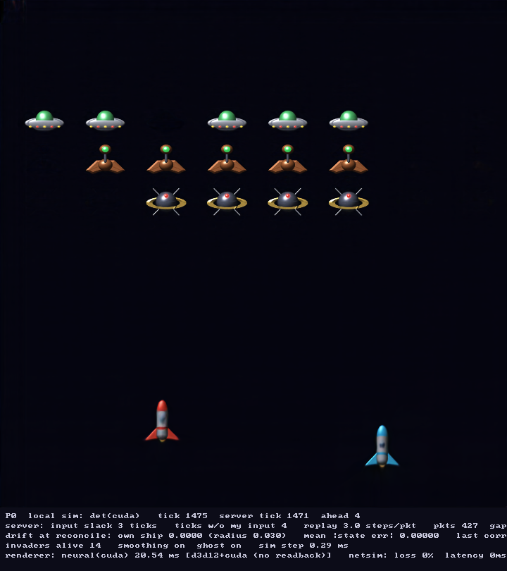

# Neural Game Engine (toy)

An experiment in building a multiplayer game engine where the **world simulation is a
neural network running on the GPU**, not hand-written game logic, and the **frame is rendered
by a second neural network** from that state.



*The Windows client (`nge_client`): every pixel above comes out of the renderer network, every
state it draws out of the world-model network; the binary contains neither game rules nor
drawing code. Press F12 in the client to save such a screenshot next to the executable.*

```
                     local inputs only                                    local inputs only
  ┌───────────────────┐ ───────────────────►  ┌───────────────────┐  ◄─────────────────── ┌───────────────────┐
  │     client 0      │                       │      server       │                       │     client 1      │
  │ world model (NN)  │ ◄───────────────────  │  world model (NN) │  ───────────────────► │ world model (NN)  │
  │   prediction +    │  authoritative state  │   authoritative,  │  authoritative state  │   prediction +    │
  │  reconciliation   │                       │   runs on the GPU │                       │  reconciliation   │
  │        │          │                       └───────────────────┘                       │        │          │
  │        ▼ state    │                                                                   │        ▼ state    │
  │ renderer (NN)     │        both ends: no hand-written game rules, no drawing code     │ renderer (NN)     │
  │ state -> pixels   │        only two neural networks and the netcode around them       │ state -> pixels   │
  │ on the GPU        │                                                                   │ on the GPU        │
  └───────────────────┘                                                                   └───────────────────┘
```

* **Server**: its only inputs are the players' remote inputs; every tick it steps the world
  model `next_state = f(state, inputs)` on the GPU and broadcasts the state.
* **Client**: reads local input (keyboard / joypad), sends it to the server, and immediately
  steps *its own copy* of the world model so the game feels responsive. When an authoritative
  state arrives the client rewinds to it and replays its buffered inputs (client-side
  prediction + server reconciliation). Lost packets are tolerated: inputs are sent with 8 ticks
  of redundancy and the server holds the last known input when one is missing.
* **Renderer**: a second network turns the state into pixels on the GPU (a per-pixel
  "spatial broadcast" network trained against a sprite compositor with a 1950s sci-fi look,
  720x720). The client shows that frame; vector drawing is a compile-time option kept for
  comparison only.
* **Toy game**: two-ship Space Invaders. Each ship is a client. If the ships collide, both
  speeds go to zero. Bullets kill invaders, the formation marches and steps down.

Two implementations share one wire format and one model file, so they interoperate freely:

| | Python (`nge/`) | C++ (`cpp/`) |
|---|---|---|
| role | research/training prototype | **Windows target**: Visual Studio / CMake |
| world model | PyTorch (CUDA) | deterministic fixed-order kernel (CPU AVX2 or CUDA via NVRTC), or ONNX Runtime |
| renderer | PyTorch (CUDA) | ONNX Runtime, CUDA execution provider (CPU fallback) |
| window, input | pygame | SDL3 (window, 2D renderer, gamepad) |
| network | UDP sockets | UDP (Winsock / BSD), same packets |

## Layout

```
nge/                 Python package
  config.py          game constants (tick rate, physics)
  state.py           flat 49-float state vector layout, helpers, random/initial states
  sim.py             reference ("classic") numpy simulation, batched over worlds -> training data
  model.py           WorldModel (residual MLP) + NeuralSim step wrapper (GPU or CPU)
  data.py train.py   data generation with mixed input policies; training loop
  evaluate.py        neural vs classic rollout drift report
  raster.py          batched GPU rasterizer of the classic look (ground truth for the renderer)
  sprites.py raster_sprites.py   procedural 1950s sprites and their GPU compositor (ground truth)
  effects.py         local explosion particles for the teacher (not game state, never on the wire)
  renderer.py train_renderer.py   neural renderer (state -> RGB) and its training
  export_onnx.py     -> checkpoints/world_model.onnx, test vectors, cpp/include/nge/layout.h
  protocol.py        packet encode/decode      netsim.py   packet loss / latency simulator
  server.py          authoritative GPU server   client.py   pygame client (+ headless bots)
cpp/                 C++20 project (CMake presets for Visual Studio 2022/2026 and Linux)
  include/nge, src/  state layout, neural_sim + neural_renderer (ONNX Runtime), protocol, net, client_core
  src/classic_sim    hand-written reference rules: linked into nge_test only (see "Clean proof")
  src/server_main    nge_server      src/client_main  nge_client (SDL3)
  src/bot_main       nge_bot (headless)   tests/test_main  nge_test (cross-check vs Python)
checkpoints/         world_model.{pt,onnx}, renderer.{pt,onnx}, test vectors, renderer_preview.png
```

## State and model

**One vector type.** Both models work on the same vector of `MODEL_DIM = 55` floats,
`[world state (49) | all player inputs (6)]`:

* World model: `x -> x_next`, same type in and out; the input slots of `x_next` come back
  zeroed ("consumed"). The server keeps one such vector, writes the remote players' inputs into
  it every tick and steps it. A client does the same with `[its local world state, i.e. the
  last network state plus its own prediction | its local input, the last remote input the
  server reported]`.
* Renderer: `(x, h, dt) -> (image, h_next)`. It takes the same vector and ignores the input
  slots by construction (they are sliced off inside the graph), so it knows nothing about how
  the state was produced. The cross-check test feeds junk in those slots and requires identical
  frames. `h` is the renderer's own *local* state (54 floats: per invader slot, seconds since it
  was last alive and where it was), advanced with the frame time `dt`; it holds the explosions
  and never goes over the wire, see "Local effects" below.

Enforced at every level: ONNX inputs/outputs `x`, `x_next`, `image`, `h`, `h_next`; C++ `ModelVector` with
`pack()`, `set_inputs()`, `state_of()` and `inputs_consumed()` (`cpp/include/nge/state.h`);
Python `WorldModel.predict(x) -> x_next`.

The whole world is one `float32[49]` vector: `2 ships x [x, y, vx, vy, cooldown]`,
`2 x 3 bullet slots x [x, y, active]`, formation `[ox, oy, moving_right]`, `18` invader alive
flags. Inputs are `2 x [ax, ay, fire]` with analog sticks in `[-1, 1]`.

The world model is a residual MLP (4 blocks, 768 wide, ~4.8M params). Continuous entries are
predicted as normalised deltas, binary flags as logits. Post-processing keeps the state on the
game manifold (threshold flags, zero inactive bullets, clamp ranges); for ONNX this is baked
into the graph with constant matrices so the C++ side needs no layout knowledge beyond the
generated header.

Training data comes from the classic numpy sim rolled over thousands of worlds with a mix of
policies (random, analog, idle, and "chaser" ships that deliberately collide). 8M transitions,
40 epochs, about 6 minutes on an RTX 4090.

Current accuracy (`python -m nge.evaluate`), neural vs classic from identical starts and inputs:

| horizon (ticks @30Hz) | ship position MAE | invader flags agree |
|---|---|---|
| 1 | 0.0003 (1% of ship radius) | 99.6% |
| 10 | 0.0014 | 98.1% |
| 30 (1 s) | 0.005 | 94% |
| 300 (10 s) | 0.09 | 81% |

One-step flag *transitions* (bullet spawn/despawn, invader kill) are right 92% of the time.
The rest is where the neural world visibly differs from the hand-written one: an occasional
bullet that passes through an invader, or a kill that happens a tick early. That is part of
what the architecture has to live with, and the client HUD shows the resulting drift.

## Rules: measured, then built in

`python -m nge.rules` rolls a world model out closed loop (its own outputs fed back, the
training input policies) and counts how often a transition breaks a rule the teacher obeys by
construction: more invaders dying than bullets consumed, an invader dying with no bullet in
its box, a bullet vanishing on screen, resurrections outside a wave reset, bullets spawning
without fire or away from the ship, ships interpenetrating or touching without stopping,
cooldown jumps, bullets drifting sideways. Rates are per 1000 ticks or per 1000 events; the
classic sim scores 0 on every rule. This is the number that says whether the learned rules are
*right*, which open-loop drift against the teacher does not.

The discrete events are not left to independent per-flag sigmoids. The world model's head
(`nge/model.py`, `WorldModel.events`) outputs, per bullet, a choice over "which invader did I
hit, or none", plus active / direction / wave-reset logits, and the next alive flags are
*derived*: `alive' = reset ? 1 : alive & ~killed`, a hit consumes its bullet. One bullet, one
kill, by construction; the derivation is plain tensor ops, so it lives inside the ONNX graph
and is mirrored in the deterministic C++ post-processing. Closed-loop fine-tuning
(`python -m nge.finetune`) then trains the model on the states it actually visits, with the
teacher's one-step answer at those states, keeping the checkpoint with the lowest violation
index.

Closed loop, 512 worlds x 600 ticks, violations per 1000 ticks (or per 1000 kills / spawns /
bullet-ticks where noted). v1 = independent flag sigmoids; v2 = structured event head; v2+ft =
v2 after closed-loop fine-tuning (4 rounds, best round kept), the shipped model.

| rule | v1 | v2 | v2+ft |
|---|---|---|---|
| multi-kill (ticks with more kills than bullets consumed) | 3.42 | **0** | **0** |
| ghost kill (per 1000 kills) | 73.6 | 9.3 | **8.5** |
| bullet vanishes on screen (per 1000 bullet-ticks) | 3.66 | **1.60** | 1.85 |
| resurrection outside a wave reset | 1.48 | **0.51** | 1.33 |
| spawn without fire (per 1000 spawns) | 138.5 | 141.8 | **75.3** |
| spawn > 0.02 from the ship (per 1000 spawns) | **74.7** | 100.4 | 135.4 |
| ships interpenetrating > 0.005 | 17.3 | 58.4 | **9.6** |
| ships touching but not stopped | **6.9** | 21.4 | 12.4 |
| cooldown jump > 0.05 without a spawn | 2.41 | **2.18** | 8.12 |
| bullet drift (per 1000 bullet-ticks) | **15.7** | 19.2 | 20.6 |

Open-loop drift against the teacher is unchanged by the head (ship position error 0.00015 per
teacher-forced step, 0.09 after 300 ticks). What the table says: the structured head removes
multi-kills by construction and cuts ghost kills eightfold; fine-tuning on the model's own
rollouts halves spawns-without-fire and interpenetration but costs some spawn placement and
cooldown precision. Fine-tuning turned out to be delicate: with the hit-class weight used for
training from scratch (8x) it raised ghost kills threefold within one round; the shipped recipe
uses a neutral weight, a 5:1 teacher-to-on-policy mix, a 2e-5 peak rate with cosine decay per
round, and keeps the round with the lowest violation index (`--rounds 4`, index 0.945).

## Neural renderer

`nge/renderer.py` maps the 49-float state to a 720x720 RGB frame. Each pixel receives the
normalised state plus Fourier features of its (x, y), its offset from each ship and bullet
position in the state (`rel_coords`) and formation-relative coordinates; a stack of 1x1 and
3x3 convolutions decides its colour. The network learns every shape, colour, visibility rule
(bullet active flags, invader alive flags, formation offsets) and the compositing. The
relative-coordinate channels only tell it *which state entries are positions*, the same layout
knowledge the export clamps use; without them (`--no-rel-coords`) the network renders ships
and invaders but never learns the small bullets.

**Look.** `nge/sprites.py` generates the art procedurally in a 1950s space-opera style: two
chrome rockets (same model, red and cyan), a different enemy per formation row (flying saucer,
War-of-the-Worlds machine, Sputnik orb) and laser bolts. Each sprite is built from signed
distance fields with a height field per part, lit by one key light with specular highlights,
supersampled and filtered, so it is re-colourable and resolution independent
(`assets/sprites/preview_sheet.png`, `preview_frame.png`). `nge/raster_sprites.py` composites
the sprites for a batch of states on the GPU with bilinear sampling, for the full frame or for
any pixel window.

**Local effects.** `nge/effects.py` adds explosions where invaders die: a hot flash, a shock
ring, sparks in the row's colour and a few debris chunks of its material, drawn by the same
compositor between the world and the ships (`assets/sprites/explosion_sheet.png`,
`explosion_frame.png`, `explosion.gif`). They are deliberately *not* game state: an explosion
is spawned when two consecutive rendered states show an alive flag going from 1 to 0, it lives
only on the machine that draws it, and it advances with frame time rather than with the
30 Hz tick (every particle is an analytic function of the explosion's age, so no integration
state exists). Nothing of it is simulated by the world model or sent over the wire.

The renderer network reproduces them from a local state of its own, `h`: one record per
invader slot, [seconds since the slot was last alive, x, y of the slot when it was last
alive]. The update is a fixed rule inside the graph (`renderer.step_fx`: an alive slot sits at
age 0 and follows the formation, a dead one ages with the frame time and keeps its centre),
of the same kind as the clamps the world-model graph carries; what the network learns is the
drawing: from (state, h) to the flash, ring, sparks and debris the teacher would draw. Each
pixel picks the one exploding slot within reach and receives its offset from that slot's
remembered centre (with the same Fourier expansion the bullets use) plus that slot's age
features, all zero when no explosion is near: one shared feature set, so the explosion is
learned once rather than once per slot (a first attempt with per-slot channels learned only
the average blob).
Training needs no sequences: because the rule is exact, (state, h) pairs are sampled directly
(`train_renderer.sample_fx`) and the teacher draws the matching explosions from the same `h`
(`Effects.from_local`), so the renderer is fine-tuned exactly like before, on crops.
On a client `h` lives in the renderer object only: the C++ `NeuralRenderer` and the Python
`RendererRuntime` loop `h_next` back into `h` every frame with the measured frame time, and
rewind/replay never touch it. `python -m nge.effects --student checkpoints/renderer.pt`
writes the teacher-vs-network comparison (`assets/sprites/explosion_student_sheet.png`, teacher
and network rows per invader type, and a side-by-side GIF).

What it took to learn them, each step found from the failure it fixed: per-slot feature
channels learned only the average blob (no weight sharing across the 18 slots), so every pixel
now selects the one exploding slot in reach and gets a single shared feature set; the sparks
are far finer than the relative-coordinate Fourier features, so the pixel also gets a polar
basis, angle harmonics up to 16 and radial frequencies up to 8 cycles per unit, in which
streaks and rings are separable; and a hard square reach mask showed through as a box around
each explosion, so the reach is circular with a soft edge. Result of the shipped checkpoint
(fine-tuned from the sprite renderer, 20k steps): 37.5 dB PSNR on frames with explosions,
96% of sprite pixels and 85% of laser pixels within 0.1 of the target (both a little better
than before), 55% of explosion pixels. The network draws the flash, the ring in the row's
colour, a radial star of sparks and the fade, at the right place and time, but soft: the
individual spark streaks are not resolved and a faint concentric texture remains around the
explosion. The frame costs about 24 ms in fp32 (torch, RTX 4090, from 19 ms) for 16k extra
parameters.

**Training** (`python -m nge.train_renderer`): states come from a pool simulated by the
classic reference sim plus random states; targets are composited on the fly, so data is
unlimited. At 720x720 a full frame is too large to backpropagate through in batches, so each
sample is a 160x160 crop (the network is per-pixel apart from two 3x3 layers, which are
evaluated with a 2 px margin so crops match the full frame exactly). Three things turned out
to matter at this resolution, each found from the failure it fixes:

* *What the crops contain.* Crops centred on objects only never show the empty column beside
  a ship, and the network drew full-height streaks there. 70% of crops are centred on a
  visible object, 15% share a row or column with one at a random distance, 15% are uniform;
  background pixels in those rows and columns are weighted 8x in the loss (objects 15x,
  lasers 40x).
* *Thin bright things need finer coordinates.* A laser bolt is a few pixels wide; with one
  relative scale for every object it was under a pixel wide in the network's coordinate space
  and was never learned (0.5% of laser pixels after 12k steps, even though a single crop could
  be memorised). Bullets get a finer relative scale and sin/cos features of the relative
  coordinates (`rel_fourier`): 19% after 2k steps, 58% after 8k.
* *Non-separable proximity.* Two bolts on one row produced a ghost band between them, because
  "right row" and "right column" were separate cues that added up. A radial-distance channel
  per object removes it.

Result of the sprite-only renderer: 41.7 dB PSNR against the compositor, 96% of object pixels
and 78% of laser pixels within 0.1 of the target (`checkpoints/renderer_preview.png`); the
shipped checkpoint adds the local explosions (see "Local effects"). The export writes
`renderer.onnx` with the float-to-RGBA8 conversion baked into the graph, so the network's
output is directly a displayable frame; the renderer ignores the input slots of the model
vector by construction. Frame time of the 560k-parameter network at 720x720 on an RTX 4090:
17 ms in fp32 (11 ms with fp16), inside the 30 Hz budget.

On Windows the C++ client keeps that frame on the GPU: the ONNX Runtime output is bound to a
CUDA buffer (I/O binding), copied device-to-device into a Direct3D 12 texture created on a
shared heap and imported into CUDA as external memory, and drawn by SDL's D3D12 renderer,
which wraps that texture. Two shared D3D12 fences (imported as CUDA external semaphores) order
the copy against the graphics queue. There is no CPU readback; `cpp/src/gpu_interop_d3d12.cpp`
holds the whole mechanism in ~150 lines. The readback path (`--no-interop`, or any non-D3D12
renderer) is kept as a fallback, and the Python client always uses readback.

## Running the Python prototype

```bash
uv sync                                   # torch (CUDA 12.4), pygame, numpy
uv run python -m nge.train --samples 8000000 --epochs 40 --hidden 768   # or use the shipped checkpoint
uv run python -m nge.evaluate
uv run python -m nge.train_renderer       # renderer network (~10 min), or use the shipped checkpoint
uv run python -m nge.train_renderer --fx --init checkpoints/renderer.pt --lr 1e-4 --steps 8000   # + local explosions (fine-tune)
uv run python -m nge.export_onnx          # ONNX (world model + renderer) + test vectors + C++ header

uv run python -m nge.server                                   # GPU world model, UDP 9999
uv run python -m nge.client --player 0                        # window, keyboard/joypad
uv run python -m nge.client --player 1 --bot chaser           # scripted opponent (window)
uv run python -m nge.client --player 1 --bot chaser --headless --log-every 2
```

Useful knobs (all programs): `--loss 0.3 --latency 80 --jitter 20` simulate a bad link,
`--classic` uses the numpy sim instead of the network (server or client side),
`--render classic` draws with vector shapes instead of the renderer network (`R` toggles live),
`--device cpu` keeps the client networks off the GPU,
`--lead N` initial ticks the client runs ahead, `--no-smooth` snaps corrections.
Client keys: arrows/WASD move, space fire, `H` toggles correction smoothing; with the classic
render compiled in, `G` toggles the server "ghost" ships and `R` neural/vector drawing.

## Building the C++ / Windows version

Prerequisites
1. Visual Studio 2022 or 2026 with the *Desktop development with C++* workload (includes CMake,
   Ninja and vcpkg; vcpkg installs SDL3 from `vcpkg.json` on first configure).
2. ONNX Runtime: downloaded automatically into `cpp/third_party/` on first configure
   (`onnxruntime-win-x64-gpu_cuda12-1.31.0.zip`, 393 MB). To use a copy you already have,
   set `ONNXRUNTIME_DIR`; to pick another package set `-DNGE_ORT_PACKAGE=onnxruntime-win-x64`
   (CPU only, 83 MB).
3. CUDA and cuDNN runtime DLLs: also downloaded automatically (NVIDIA's public
   redistributables, CUDA 12.8 components + cuDNN 9.27 for CUDA 12, about 3.3 GB once) and
   deployed next to the executables together with the ONNX Runtime DLLs, so no CUDA Toolkit
   or cuDNN install is needed. The cudart headers from the same package power the D3D12
   interop. With a toolkit installed you can skip the download:
   `-DNGE_CUDA_REDIST=OFF -DCUDA_PATH=... -DCUDNN_PATH=...`. Only an NVIDIA driver is required
   at runtime.
4. The models: `checkpoints/world_model.onnx` and `checkpoints/renderer.onnx` (exported from Python, included).

Build: *File > Open > Folder* on `cpp/` in Visual Studio, pick the `windows-ninja` preset
(default) and build; executables and all DLLs land in `cpp/build/windows/bin/`. For a classic `.sln`:
```powershell
cd cpp
cmake --preset windows-vs2026          # or windows-vs2022 -> cpp/build/vs2026/neural_game_engine.sln
cmake --build --preset windows-vs2026
ctest --preset windows-vs2026          # cross-check against the Python reference (needs the test vectors:
                                       #   `uv run python -m nge.export_onnx` regenerates them; they are not in git)
```
If you run cmake from a plain terminal instead of the VS developer prompt, set `VCPKG_ROOT`
(the VS-bundled copy is `C:\Program Files\Microsoft Visual Studio\18\Community\VC\vcpkg`).

Run (from `cpp/build/windows/bin/`, or `cpp/build/vs2026/bin/`)
```powershell
.\nge_server.exe                                   # neural world on the GPU (CUDA EP)
.\nge_client.exe --player 0                        # SDL3 window, keyboard or gamepad; world model + renderer on the GPU
.\nge_client.exe --player 1 --bot chaser           # or a second human on another PC: --server host:9999
.\nge_bot.exe --player 1 --bot random              # headless scripted client
```
Python and C++ components mix freely (e.g. Python server with C++ clients).

On Linux/WSL only the headless targets build (`cmake --preset linux-ninja`); set
`ONNXRUNTIME_DIR` to the extracted `onnxruntime-linux-x64-<ver>.tgz`.

## Clean proof: no game rules in the runtime

The reference simulation (`nge/sim.py`, ported to `cpp/src/classic_sim.cpp`) is only the
*teacher*: it generates training data and serves as the baseline in `nge_test` and
`nge.evaluate`. By default it is **not linked** into `nge_server`, `nge_client` or `nge_bot`
(`NGE_WITH_CLASSIC_SIM=OFF`); those binaries contain no transition rule other than the network
and exit with an error if the model cannot be loaded, instead of falling back. `nm`/`dumpbin`
on the executables shows no `ClassicSim` symbol. The same applies to drawing: the vector
renderer and the ghost/outline overlays (`cpp/src/classic_render.cpp`) are compiled into the
client only with `-DNGE_WITH_CLASSIC_RENDER=ON`; by default the window shows nothing but the
renderer network's frames plus HUD text, and the client exits if `renderer.onnx` cannot be
loaded. Configure with `-DNGE_WITH_CLASSIC_SIM=ON -DNGE_WITH_CLASSIC_RENDER=ON` to get
`--classic`, `--render classic`, the `R` toggle and the `G` ghost overlay back for A/B
comparisons. What remains hand-written in the default runtime: the state layout and value
ranges, the start arrangement, the HUD text, and the bots (players, not engine).

## Determinism

Two machines stepping the same model from the same vector must produce the same bits. ONNX
Runtime does not guarantee that across GPUs (TF32, kernel selection, reduction order), so the
engine has its own implementation of the world model, the default (`--sim onnx` selects ONNX
Runtime instead):

* `cpp/include/nge/det_math.h`: the arithmetic contract, one header compiled both by the host
  compiler and by NVRTC. Every operation is an IEEE-754 fp32 operation in a fixed order: fmaf
  chains from the bias in ascending input index, sequential LayerNorm sums, our own `exp`
  polynomial, correctly rounded division and sqrt, no flush-to-zero, no contraction.
* CPU backend (`det(cpu)`): AVX2 + FMA intrinsics; each SIMD lane runs the same fma chain as one
  GPU thread. `det(cpu-scalar)` is the plain scalar reference used by the tests.
* CUDA backend (`det(cuda)`): one kernel (`cpp/src/det_kernel.cu`), one block of `hidden` threads,
  compiled at runtime by NVRTC with `--fmad=false --ftz=false --prec-div=true --prec-sqrt=true`
  for the GPU in the machine and loaded through the driver API. Driver and NVRTC are loaded
  dynamically with our own declarations: no CUDA toolkit, headers or import libraries are
  needed to build, and a machine without an NVIDIA driver uses the CPU backend.
* Weights: `checkpoints/world_model.nge`, raw fp32 arrays written by `python -m nge.export_det`
  (also produced by `python -m nge.export_onnx`). Same checkpoint as the ONNX file.
* Post-processing (threshold, clamp, zero inactive bullets, consume inputs) runs on the host for
  every backend.

`nge_determinism` rolls each backend 600 ticks from the canonical start with a scripted,
platform-independent input sequence, hashes every intermediate state and compares:

| backend | result on the RTX 4090 / x86 machine |
|---|---|
| `det(cpu)`, `det(cpu-scalar)`, `det(cuda)` | identical hash `edadd50658a76fda`, each repeatable, on Windows (MSVC) and WSL (GCC) |
| `det(cpu)` vs ONNX Runtime CPU | max diff 6.9e-4 over 600 ticks, no flag mismatches (different arithmetic, expected) |
| ONNX Runtime CPU vs CUDA (TF32 off) | max diff 1.2e-4, differ from tick 0 |

`nge_test` additionally requires `det(cuda)` and `det(cpu-scalar)` to be bit-identical with
`det(cpu)` over the 2048 test vectors. Compare the printed hashes between machines. The renderer
does not need any of this: pixels never feed back into the state.

## Performance: one GPU, several processes

Each client renders a 720x720 frame per tick, about 17 ms on an RTX 4090, so two clients plus
the server on one GPU exceed the 33 ms tick. The client never lets rendering delay the
simulation: when it is behind schedule it runs the missed ticks first and skips the neural
render for that iteration (the previous frame stays on screen), so its inputs keep reaching
the server on time. `--log-every 2` prints the loop, simulation and render times plus the
number of skipped renders and catch-up ticks. For a shared-GPU test, give one or both clients
the lighter renderer: `--renderer checkpoints/renderer_480.onnx` (same weights exported at
480x480, about 8 ms). In the intended deployment each client has its own GPU.

## What to look at while playing

The HUD reports: how many ticks the client runs ahead, the input slack the server sees, ticks
where the server had to hold your input, replay steps per packet, lost packets, and the drift
between what the client predicted and what the server actually computed. With `--loss 0.3`
you can watch the own-ship correction grow and the ghost ships lag behind.

## Prior art (as of October 2026)

The neural-engine idea is a hot research area but almost all of it predicts *video frames*,
not an explicit, inspectable game state:

* GameNGen (DOOM), DIAMOND (Atari), Oasis (Minecraft), Genie 3: single-player frame-prediction
  world models.
* Enigma Labs' Multiverse (May 2025, MIT, github.com/EnigmaLabsAI/multiverse): first
  two-player world model (Gran Turismo-style racing), both players on one keyboard, no network.
* "Multiplayer Interactive World Models with Representation Autoencoders" (arXiv 2607.05352):
  4-player Rocket League latent diffusion, 5B params, 20 fps on a B200.
* **MASS: Multiplayer World Models with Authoritative Shared State** (arXiv 2608.06257, August
  2026): the closest to this project. A learned *Logic Engine* advances a typed global state
  from joint player actions and is the single authority; a separate learned *Rendering Engine*
  produces per-player views; clients advance the last authoritative state locally between
  packets. Benchmarked on multiplayer Snake with 1024 concurrent players. No code release
  found as of October 2026.
* GameGAN (NVIDIA, 2020) and GameDirector (arXiv 2609.25652) also split a dynamics network from
  a rendering network, single-player; GameDirector makes the same argument for the split that
  this project makes (pixel models cannot enforce precise, consistent state transitions).
* Roblox "Reality" hybrid architecture (April 2026): classic authoritative server for shared
  state, neural model only for visuals, with speculative client-side simulation.
* On GitHub (searched October 2026): `RobvanGastel/multiplayer-world-model` (MIRA
  reproduction, two-player air hockey, pixels in / pixels out, no network) and
  `GaganGutta/neural-game-engine` (single-player Doom world model, 41 fps on a CPU) are the
  nearest working code. Neither has an explicit state, a server, or a separate renderer.

None of the above does what this toy does: run the learned state model *on both ends* with
standard netcode (prediction, rewind, replay) to hide latency and loss, with an explicit
state as the wire format, and with inference that is bit-identical across CPUs and GPUs so
that server and clients agree exactly. That combination appears to be unoccupied ground.

See `docs/NOTES.md` for the current working notes, the determinism baseline and the agreed
design of the deterministic world-model kernel.

## Ideas / next steps

* Batched rooms: the GPU model can step thousands of matches in one forward pass (`step_torch`
  already takes a batch); the server could host N rooms for the price of one.
* Keep the state resident on the GPU (ONNX Runtime IO binding) instead of copying 49 floats
  per tick; relevant once the state is a large latent rather than 49 floats.
* Make the network write straight into the shared texture memory (bind the ONNX output to a
  shared D3D12 *buffer* and let D3D12 copy buffer to texture) to drop the one remaining
  device-to-device copy; add a Vulkan variant of the interop for Linux.
* Renderer: fp16 export for the 720 renderer if the budget gets tight; a 16:9 window with the
  HUD beside the square world; more local effects on the same mechanism (ship hit flashes,
  engine trails: each is a few more slots in `h`), and variety per explosion (a per-slot
  rotation of the relative coordinates would give every slot its own spark pattern for free).
* Train on the model's own rollouts (closed-loop fine-tuning) to shrink long-horizon drift.
* Not planned: a learned latent on the wire. The explicit 49-slot state stays the protocol;
  anything that need not be synchronised (effects) lives locally in the renderer, as above.

## License

MIT, see `LICENSE`. Third-party components downloaded at build time (ONNX Runtime, SDL3, the
NVIDIA CUDA / cuDNN / NVRTC redistributables) keep their own licences, see
`THIRD_PARTY_NOTICES.md`.
